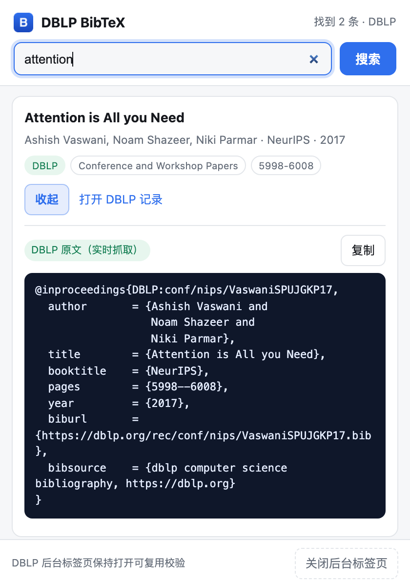

# DBLP BibTeX

**English** | [简体中文](README.zh.md)

[](https://github.com/tangquanwei/dblp-bibtex/actions/workflows/ci.yml)
[](LICENSE)
[](https://developer.chrome.com/docs/extensions/develop/migrate/what-is-mv3)

**Search DBLP from your toolbar and copy the original BibTeX — using your own browser session to pass DBLP's bot check.**



> Screenshot taken against a local mock of the DBLP API (see [Testing](#testing)).

## Why

DBLP now answers non-browser clients with an [Anubis](https://anubis.techaro.lol/) proof-of-work challenge (`HTTP 202` + "Making sure you're not a bot"). That blocks the obvious implementation: an extension calling `https://dblp.org/search/publ/api` directly gets the challenge page, not JSON.

Instead of solving or forging the challenge, this extension reuses the user's own browser:

1. It opens a **background tab** at `https://dblp.org/` (`chrome.tabs.create({ active: false })`).
2. The tab is a real page, so the browser runs Anubis' JavaScript exactly as it would for a human visitor.
3. Once the challenge passes, the `dblp.org` cookie lives in that tab.
4. A content script performs **same-origin fetches** from that page to
   `/search/publ/api` and `/rec/<key>.bib?param=1`, carrying the cookie.
5. The popup renders the results and copies the BibTeX to the clipboard.

No proof-of-work implementation, no cookie spoofing, no `--headless` tricks.

## Install

Requires Chrome or Edge (Manifest V3). There is no build step.

```sh
git clone https://github.com/tangquanwei/dblp-bibtex.git
```

1. Open `chrome://extensions/` (Edge: `edge://extensions/`).
2. Enable **Developer mode**.
3. Click **Load unpacked** and select the repository folder (the one containing `manifest.json`).
4. Pin the extension to the toolbar.

## Usage

- Type a paper title (or part of it) and press Enter.
- **First run** takes ~5–15 s: a DBLP tab opens in the background while the browser completes the check.
- The first result expands automatically; click **Copy**.
- Later searches reuse the tab and usually finish in 1–2 s.

You can also paste a DBLP record URL, e.g.
`https://dblp.org/rec/conf/nips/VaswaniSPUJGKP17.html`, to fetch that entry's `.bib` directly.

If the popup is closed while waiting, reopening it restores the last results.

## Permissions

| Permission | Why |
|---|---|
| `tabs` | Create/reuse the DBLP background tab and read its URL |
| `storage` | Remember the tab id and the last results (session storage only) |
| `clipboardWrite` | Copy the BibTeX |
| `https://dblp.org/*` | Inject the content script and make same-origin requests |

No `<all_urls>`, no page scraping beyond `dblp.org`, no telemetry. See [PRIVACY.md](PRIVACY.md).

## Testing

- **Automated, end-to-end:** the extension is loaded into Chrome for Testing (headless), pointed at a local mock that mimics DBLP's JSON API and `.bib` endpoints. The test covers tab creation, content-script injection, search, rendering, `.bib` fetching, copy wiring, and restoring results after reopening the popup.
- **Real DBLP (manual):** verified on 2026-11-03 in desktop Chrome 156 on macOS 27 — the background tab passes DBLP's Anubis challenge, the search returns results, and the `.bib` endpoint returns the original entry. CI cannot cover this step because DBLP rejects headless browsers ("Oh noes!"), so it stays a manual check.

Run the local checks:

```sh
npm run check   # manifest, file layout, PNG signatures, JS syntax
npm run pack    # dist/dblp-bibtex-<version>.zip
```

## How it fits together

```
popup.js ──runtime message──▶ sw.js ──tabs.create──▶ https://dblp.org/ (background tab)
   ▲                             │                         │
   │                             │  chrome.tabs.sendMessage│ content script (content.js)
   └──── results / BibTeX ◀──────┴─────────────────────────┘
                                    same-origin fetch:
                                    /search/publ/api
                                    /rec/<key>.bib?param=1
```

| File | Role |
|---|---|
| `manifest.json` | MV3 manifest: permissions, background worker, content script |
| `sw.js` | Tab lifecycle, retries while the challenge is in flight, message routing |
| `content.js` | Same-origin DBLP requests plus JSON → result mapping |
| `popup.html/js/css` | Search UI, result list, copy |
| `scripts/` | `check` and `pack` helpers used by CI |

## Limitations

- **First search is slow** while the browser completes DBLP's check.
- **Keep the DBLP tab open** to reuse the session; the footer has a button to close it.
- **Not a scraper.** One query per click; bulk crawling will get your IP challenged.
- **DBLP-only by design.** Entries without a DBLP record (e.g. some arXiv preprints) will not be found.
- **UI is Chinese.** English/localized UI is welcome as a PR.
- If DBLP changes its API or challenge, `content.js` is the place to adjust.

## Contributing

Issues and PRs are welcome — see [CONTRIBUTING.md](CONTRIBUTING.md).

## License

[MIT](LICENSE)
