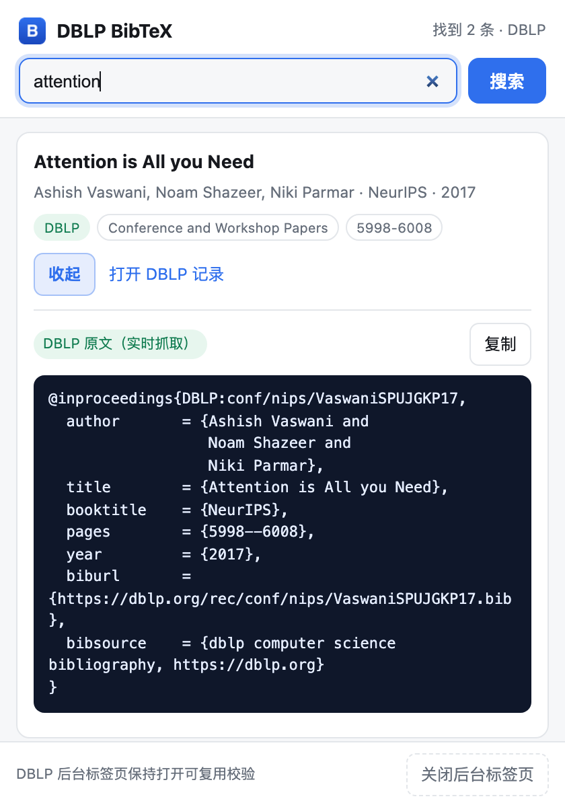

# DBLP BibTeX

**简体中文** | [English](README.md)

[](https://github.com/tangquanwei/dblp-bibtex/actions/workflows/ci.yml)
[](LICENSE)
[](https://developer.chrome.com/docs/extensions/develop/migrate/what-is-mv3)

**在浏览器工具栏里搜 DBLP，复制 DBLP 的原始 BibTeX——用你自己的浏览器会话通过 DBLP 的人机校验。**



> 截图为本地 mock 的 DBLP 接口（见[测试](#测试)）。

## 为什么要这么绕

DBLP 现在对非浏览器客户端返回 [Anubis](https://anubis.techaro.lol/) 的工作量证明挑战（`HTTP 202` + "Making sure you're not a bot"）。扩展如果直接 `fetch` `https://dblp.org/search/publ/api`，拿到的只会是挑战页，不是 JSON。

这个扩展不去实现或伪造挑战，而是复用你自己的浏览器：

1. 用 `chrome.tabs.create({ active: false })` 开一个 `https://dblp.org/` 后台标签页；
2. 这个标签页是真实页面，Anubis 的 JS 由浏览器自己跑完（和你手动打开 DBLP 完全一样）；
3. 校验通过后，`dblp.org` 的 cookie 就在这个标签页里；
4. content script 在这个页面里做**同源 fetch**：`/search/publ/api` 和 `/rec/<key>.bib?param=1`，自动带上 cookie；
5. 弹窗渲染结果，点「复制」写入剪贴板。

没有实现 PoW、没有伪造 cookie、没有 headless 技巧。

## 安装

需要 Chrome 或 Edge（Manifest V3），无构建步骤。

```sh
git clone https://github.com/tangquanwei/dblp-bibtex.git
```

1. 打开 `chrome://extensions/`（Edge 是 `edge://extensions/`）；
2. 打开**开发者模式**；
3. 点**加载已解压的扩展程序**，选择仓库根目录（含 `manifest.json` 的那层）；
4. 固定到工具栏。

## 使用

- 输入论文名（或名字的一部分），回车；
- **首次**约 5–15 秒：后台打开 DBLP 标签页，浏览器完成校验；
- 第一条结果自动展开，点**复制**；
- 之后再搜复用同一个标签页，通常 1–2 秒。

也可以直接粘贴 DBLP 记录链接（如 `https://dblp.org/rec/conf/nips/VaswaniSPUJGKP17.html`），直接取这条的 `.bib`。

弹窗在等待时被关掉也没关系，重新打开会恢复上一次结果。

## 权限

| 权限 | 用途 |
|---|---|
| `tabs` | 创建/复用 DBLP 后台标签页，读取它的 URL |
| `storage` | 记住标签页 id 与上一次结果（仅 session） |
| `clipboardWrite` | 复制 BibTeX |
| `https://dblp.org/*` | 注入内容脚本、发同源请求 |

没有 `<all_urls>`，不读取你在别的网站的页面内容，不上报任何数据。详见 [PRIVACY.md](PRIVACY.md)。

## 测试

- **端到端自动化**：把扩展装进 Chrome for Testing（headless），指向一个模拟 DBLP JSON 接口与 `.bib` 端点的本地 mock，覆盖标签页创建、内容脚本注入、搜索、渲染、`.bib` 抓取、复制按钮、重开弹窗恢复结果。
- **CI 不覆盖**：真实 DBLP 的 Anubis 校验。headless 浏览器会被 DBLP 拒绝（"Oh noes!"），真实站点只能在普通桌面浏览器里手动验证。

本地检查：

```sh
npm run check   # 校验 manifest、文件布局、PNG 签名、JS 语法
npm run pack    # 生成 dist/dblp-bibtex-<version>.zip
```

## 工作原理

```
popup.js ──runtime 消息──▶ sw.js ──tabs.create──▶ https://dblp.org/（后台标签页）
   ▲                          │                        │
   │                          │  sendMessage           │ content script (content.js)
   └──── 结果 / BibTeX ◀──────┴────────────────────────┘
                                同源 fetch：
                                /search/publ/api
                                /rec/<key>.bib?param=1
```

| 文件 | 作用 |
|---|---|
| `manifest.json` | MV3 清单：权限、后台 worker、内容脚本 |
| `sw.js` | 标签页生命周期、校验期间的重试、消息路由 |
| `content.js` | 同源请求 DBLP，JSON → 结果映射 |
| `popup.html/js/css` | 搜索界面、结果列表、复制 |
| `scripts/` | `check` / `pack`，CI 使用 |

## 限制

- 首次搜索需要等浏览器完成 DBLP 校验；
- 保持 DBLP 标签页打开可复用会话，页脚有「关闭后台标签页」；
- 不是爬虫：一次一条、人点一下，批量请求会被 DBLP 拦截；
- 只查 DBLP：没有 DBLP 条目的论文（比如部分 arXiv 预印本）搜不到；
- 界面目前是中文，欢迎 PR 做 i18n；
- DBLP 改接口或换校验方式时，改 `content.js`。

## 贡献

欢迎 issue 和 PR，见 [CONTRIBUTING.md](CONTRIBUTING.md)。

## 许可

[MIT](LICENSE)
